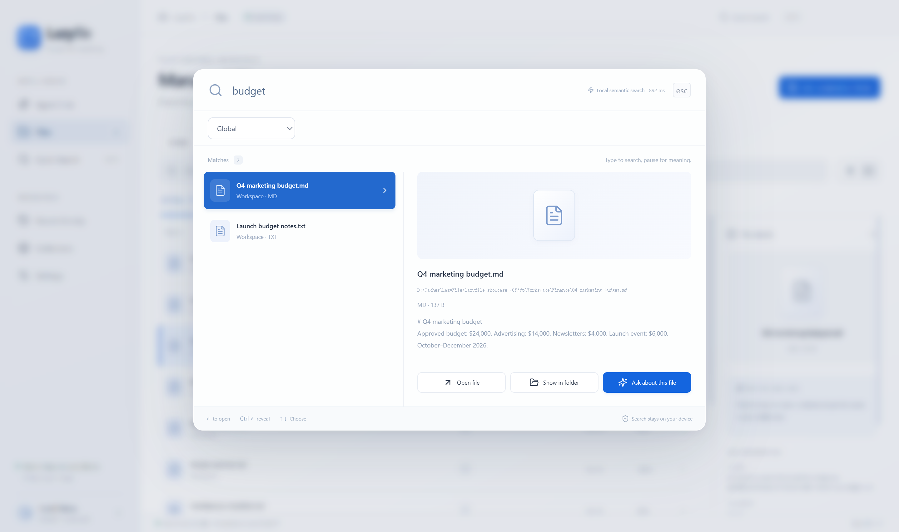
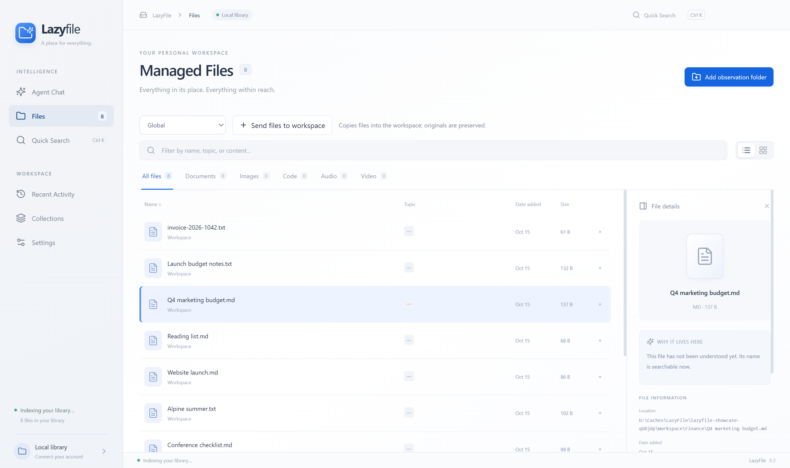
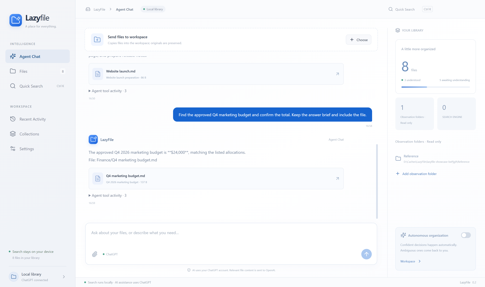
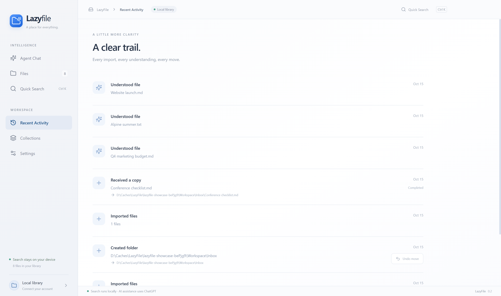
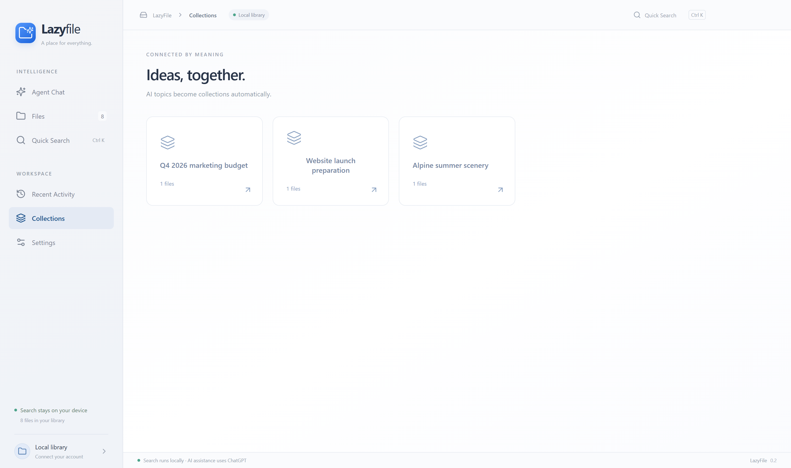
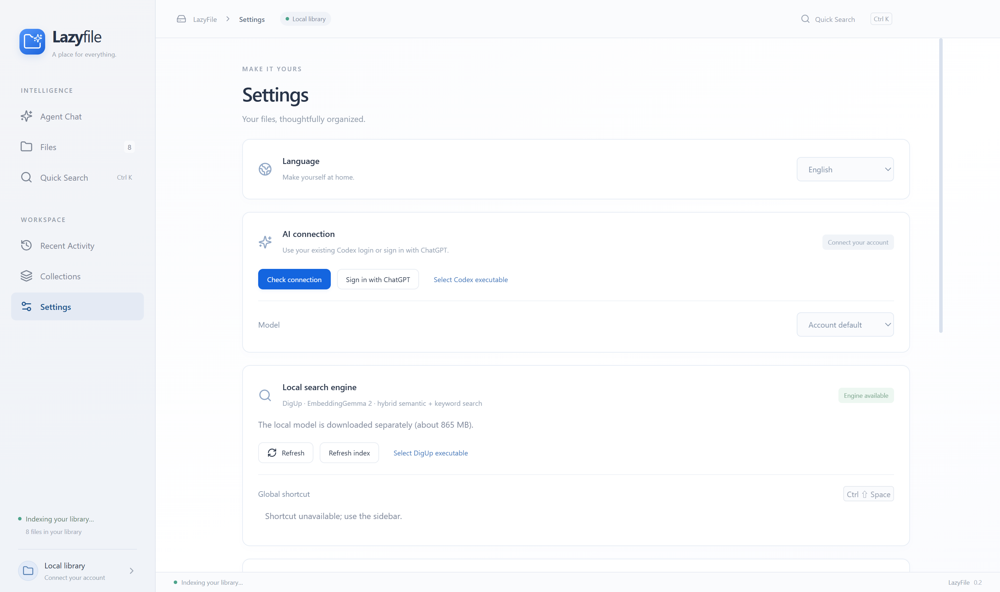
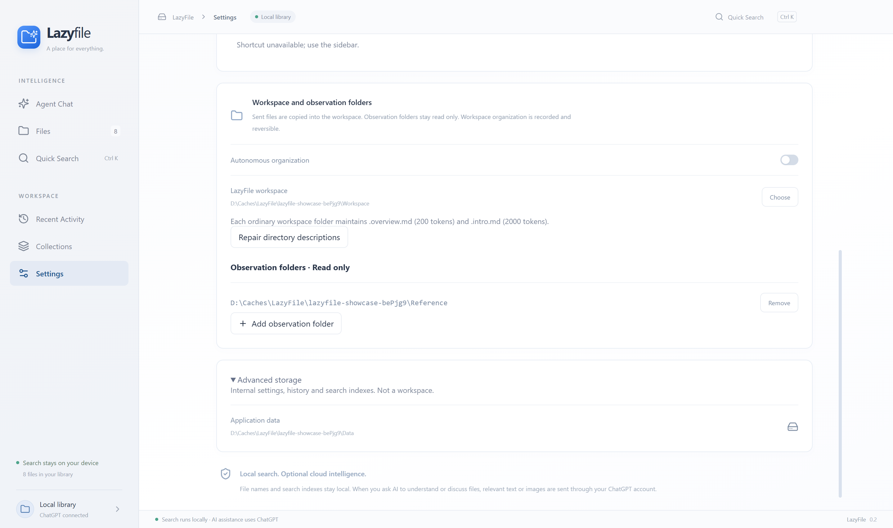

# LazyFile

**Find the file you remember, even when you forget its name.**

LazyFile is a focused desktop tool for finding files. Describe what you need, search by an exact phrase, or ask an assistant to look through your folders and check the contents.

English · [简体中文](README.zh-CN.md)

*The real desktop app, using a small demonstration library.*

## Find it your way

- **“The budget for last quarter.”** Search by meaning when you cannot remember a filename.
- **“Invoice 2026-1042.”** Find an exact number, name or phrase in filenames and extracted text.
- **“湖边木屋的夏日度假.”** A Chinese query can find an English note about a summer stay by an alpine lake.
- **“Find the approved budget and confirm the total.”** Let the assistant search, browse the relevant folders and read the document before answering.

Quick search combines local semantic and keyword retrieval, powered by [DigUp](https://github.com/ARahim3/DigUp) and EmbeddingGemma 2. Open it from another app with **Ctrl + Shift + Space** on Windows, or use **Ctrl + K** inside LazyFile.

The assistant can move between search results, folder guides and file contents. It can narrow the search as it goes, rather than relying on a single query. Results link back to the actual files so you can preview, open or reveal them in their folder.

## A tour of LazyFile

These screenshots show the real desktop app with a separate demonstration library. The topics, summaries and assistant messages come from actual AI analysis of the sample files.

### Files — browse your library

View workspace files and read-only observation files together, or filter by source and file type. Switch between list and grid views, filter the file list, and select a file to inspect its location, analysis status and available AI notes. Open it, reveal it in its folder, or ask the assistant about it from the details panel.

### Agent Chat — ask for help finding a file

Describe what you remember or ask a question about a selected file. The assistant can combine search, folder browsing and reading to check the answer. Send files into the workspace from the attachment controls; the sidebar shows library status, observation folders and the optional autonomous organization setting.

The example below shows a real lookup: “Find the approved Q4 marketing budget and confirm the total.” The assistant answers with the amount and a file card you can open.

### Recent Activity — see what happened

Review imports, file understanding and workspace operations in one timeline. Eligible workspace moves and folder creations have an undo action; undo still checks for changed files and conflicting destinations. The example below records a real copy of a demonstration file into the workspace.

### Collections — browse by topic

After AI understanding assigns topics, files with the same topic appear together in a collection. Open a collection to browse its files. Collections are a view of file metadata, so viewing one does not move files. Here, the budget, travel and website samples have been analyzed to create real topic collections.

### Settings — choose connections and folder access

Switch between English and Simplified Chinese, connect your ChatGPT account, choose an AI model, and check or configure the local DigUp search engine. Model download and index refresh controls are here too.

Further down, choose the single writable workspace, add or remove read-only observation folders, toggle autonomous organization, and repair workspace folder guides. Advanced storage shows where LazyFile keeps its own settings, history and indexes; it is separate from your workspace.

## Your folders, your boundaries

LazyFile works with two kinds of folders:

| Folder | What LazyFile can do |
| --- | --- |
| **Observation folders** — as many as you need | Read and search. Your files stay where they are, and LazyFile does not change them. |
| **LazyFile workspace** — one folder | Read, search and organize the files you give it. |

Search defaults to **all authorized folders**. You can switch to the workspace or a specific folder within either scope. Adding observation folders is enough to use search; a workspace is needed when you want to send files for organization.

Send a file to the assistant and LazyFile copies it into the workspace, keeping the original. With autonomous organization enabled, the assistant chooses a suitable place, creates subfolders when useful, and asks a focused question when important context is missing. Moves are recorded and can be undone when the files have not changed or collided with newer files.

Ordinary workspace folders contain two short guides, `.overview.md` and `.intro.md`, which help the assistant navigate and stay oriented. LazyFile maintains them as the contents change. Repositories and software packages are kept intact; observation folders receive no new guides.

## Local search, optional cloud assistance

**Quick search runs on your computer.** Search indexes and embedding inference stay local. After downloading the search models, quick search does not need a ChatGPT login.

**The assistant uses your ChatGPT account through Codex.** Relevant text, images and tool results used in a task are sent to OpenAI for processing. This also applies to automatic file understanding when an account is connected. Account access and usage limits apply; assistant features are not fully offline.

Only folders you explicitly authorize are available to the assistant. Sending one file does not give it access to that file’s original parent folder.

## Get started

LazyFile **0.2 is an early preview**. Windows has been tested; macOS is a target, but has not yet been validated on a Mac. The interface supports English and Simplified Chinese.

Packaged downloads have not been published to this repository yet. To run the preview from source, follow the [development guide](docs/development.md).

Once the app is running:

1. **Choose your folders.** Add observation folders for search, and optionally select a workspace for files you want LazyFile to organize.
2. **Set up local search.** Use Settings to download the models, about 865 MB once. Let the initial index finish; a newly selected search scope may need its own indexing pass.
3. **Start searching.** Type a description, filename or exact phrase. Select a result to see its preview.
4. **Connect the assistant when you need it.** Install Codex CLI, then use Settings to check your existing login or sign in with ChatGPT. Ask it to find a file, verify a detail, or organize a file you send.

| Windows shortcut | Action |
| --- | --- |
| `Ctrl + Shift + Space` | Open quick search from another app while LazyFile is running |
| `Ctrl + K` | Open quick search inside LazyFile |
| `↑` / `↓` | Select a result |
| `Enter` | Open the selected file |
| `Ctrl + Enter` | Show the file in its folder |
| `Esc` | Close quick search |

## What it can read

Search works with supported documents, images, audio, video and code through the local DigUp engine. The assistant can read extracted text from text files, DOCX and PDFs, and inspect supported images.

The preview has some practical limits:

- Assistant text extraction is limited to 60,000 characters per file and the first 40 pages of a PDF. Audio and video understanding in chat is currently metadata-only.
- The file inventory scans up to 5,000 files per root, skipping hidden files and dependency trees. Incomplete scans are reported.
- Workspace organization is optional. Turn it off to keep search and file understanding without automatic moves.

## Development and feedback

See the [development guide](docs/development.md) for setup, builds and tests, and the [architecture notes](docs/architecture-decisions.md) for implementation decisions.

Found a problem or have a focused improvement in mind? [Open an issue](https://github.com/leileqiTHU/LazyFile/issues). Include your operating system and steps to reproduce; use a small sample file rather than personal documents.

## Thanks

LazyFile builds on [DigUp](https://github.com/ARahim3/DigUp), whose local search engine makes semantic and keyword retrieval possible, and Google DeepMind’s EmbeddingGemma 2. The assistant connects through OpenAI’s Codex app-server. The desktop app uses Electron and React.

## License

LazyFile’s original code is licensed under [MIT](LICENSE). Third-party components and model weights retain their own licenses; see [third-party notices](THIRD-PARTY-NOTICES.md).
